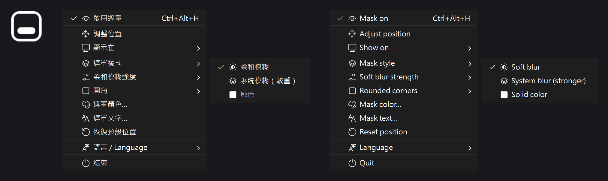

<h1 align="center">ScreenMask</h1>

<p align="center">
  在螢幕上蓋一塊模糊遮罩，擋住不想被看到的內容<br>
  A blur overlay that hides anything you don't want on screen
</p>

<p align="center">
  <a href="https://github.com/Yeh0706/screenmask/releases">下載 Download</a> ·
  <a href="#繁體中文">繁體中文</a> ·
  <a href="#english">English</a>
</p>

<p align="center">
  
</p>

---

## 繁體中文

ScreenMask 是一個常駐在系統匣的小工具。它會在遊戲或任何視窗上蓋一塊模糊（或純色）遮罩，擋住不想被看到的內容。截圖、錄影、直播時都不用再後製。

### 功能

- **三種遮罩樣式**
  - 柔和模糊：可以調強度（輕／中／重／很重），邊緣往外漸層，跟畫面自然融合
  - 系統模糊：Windows 內建的模糊效果，比較重
  - 純色：可自選顏色
- **圓角**：無、小、中、大、全圓（膠囊形）五段
- **顯示在**
  - 跟著指定視窗：只在那個視窗位於最前面時顯示，範圍限制在視窗內，視窗縮放時跟著等比例縮放
  - 全局顯示：一直顯示在螢幕上，可以放在任何一個螢幕
- **調整位置**：直接拖曳移動、拖邊縮放。位置以最近的角落為基準記錄，預設在左上角
- **自訂文字**：在遮罩上顯示文字，可以設定字型、大小、對齊、顏色、粗體、陰影
- **開關**：左鍵點系統匣圖示，或按 `Ctrl+Alt+H`，不用結束程式
- **不影響操作**：滑鼠會穿透遮罩，也不會搶走遊戲的焦點
- **介面語言**：繁體中文／简体中文／English
- 支援多螢幕、不同縮放比例

### 安裝與使用

1. 到 [Releases](https://github.com/Yeh0706/screenmask/releases) 下載 `ScreenMask.zip`。
2. **先解壓縮**，再執行資料夾裡的 `ScreenMask.exe`。`_internal` 資料夾必須跟 exe 放在一起。
3. 程式會常駐在系統匣（右下角）：
   - **左鍵**點圖示：開／關遮罩
   - **右鍵**點圖示：打開選單
4. 第一次使用：右鍵 →「顯示在」選要遮的視窗（預設是星穹鐵道 `StarRail.exe`），再用「調整位置」把框拖到要遮的地方，最後按「完成調整」。

> Windows Defender 可能會跳出警告，這是 PyInstaller 打包程式常見的誤判。按「其他資訊」→「仍要執行」即可。

**注意**：遊戲如果開「獨佔全螢幕」，遮罩可能蓋不上去，請改用「視窗化」或「無邊框」。

### 資料存放位置

| 內容 | 位置 |
|---|---|
| 設定（位置、樣式、文字、語言等） | `%APPDATA%\ScreenMask\config.json` |
| 錯誤紀錄（程式啟動失敗時看這裡） | `%APPDATA%\ScreenMask\error.log` |

### 從原始碼執行

需要 Python 3.10 以上，在 Windows 上執行：

```bash
pip install -r requirements.txt
pythonw ScreenMask.pyw
```

或直接雙擊 `Start-ScreenMask.bat`。

---

## English

ScreenMask is a small tray app. It puts a blur (or solid color) overlay on top of a game or any window to hide what you don't want shown, so screenshots, recordings and streams need no editing afterwards.

### Features

- **Three mask styles**
  - Soft blur: adjustable strength (Light / Medium / Heavy / Very heavy), with a soft edge that fades outward into the picture
  - System blur: Windows' built-in blur, stronger
  - Solid color: pick any color
- **Rounded corners**: None, Small, Medium, Large, Full (pill)
- **Show on**
  - Follow a window: shown only while that window is in front, kept inside it, and scaled with it when it resizes
  - Global: always on screen, on any monitor
- **Adjust position**: drag to move, drag the edges to resize. The position is stored relative to the nearest corner; the default is the top-left
- **Custom text**: show text on the mask, with font, size, alignment, color, bold and shadow options
- **On/off**: left-click the tray icon or press `Ctrl+Alt+H`; no need to quit
- **Doesn't get in the way**: mouse clicks pass through the mask, and it never steals focus from the game
- **UI language**: Traditional Chinese / Simplified Chinese / English
- Works with multiple monitors and mixed display scaling

### Install & use

1. Download `ScreenMask.zip` from [Releases](https://github.com/Yeh0706/screenmask/releases).
2. **Extract it first**, then run `ScreenMask.exe`. Keep the `_internal` folder next to the exe.
3. ScreenMask lives in the system tray (bottom right):
   - **Left-click** the icon: turn the mask on/off
   - **Right-click** the icon: open the menu
4. First time: right-click → "Show on" to pick the window to cover (Honkai: Star Rail `StarRail.exe` by default), then "Adjust position" to drag the box over what you want to hide, and "Finish adjusting".

> Windows Defender may show a warning. This is a common false positive for PyInstaller apps. Click "More info" → "Run anyway".

**Note**: if the game runs in exclusive fullscreen, the mask may not appear on top. Use windowed or borderless mode.

### Where data is stored

| What | Where |
|---|---|
| Settings (position, style, text, language, …) | `%APPDATA%\ScreenMask\config.json` |
| Error log (check this if the app fails to start) | `%APPDATA%\ScreenMask\error.log` |

### Run from source

Requires Python 3.10+ on Windows:

```bash
pip install -r requirements.txt
pythonw ScreenMask.pyw
```

Or just double-click `Start-ScreenMask.bat`.

---

## 授權 / License

ScreenMask 的原始碼以 [MIT License](LICENSE) 釋出。
The ScreenMask source code is released under the [MIT License](LICENSE).

打包後的程式包含 PySide6（LGPL-3.0），該元件適用其自身的授權條款。
Packaged builds include PySide6 (LGPL-3.0), which remains under its own license.
